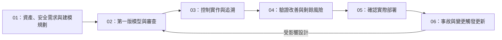

# 威脅建模本機整併預覽

## 設定與生命週期

**安全基準已啟用，或使用者明確要求／選取威脅建模時，威脅模型為必要交付物；其餘情況為選用。**

Phase 02 完成模型不代表控制已驗證，Phase 04 驗證完成也不代表模型永久停止更新。

## 先看這三份文件

1. [整併後 Skill](../skills/02_system_design/threat-modeling/SKILL.md)：建模步驟、啟用條件、候選／驗證狀態、追溯要求。
2. [生命週期與 IO／SSOT 規則](THREAT_MODELING_LIFECYCLE.md)：六階段交接、必要交付何時檢查、設定與路徑。
3. [既有 App／API 案例的模型預覽](../project_demos/mobile-app-api-reverse-threat-model/preview/threat_model.md)：保留原五筆威脅，增加覆蓋、候選需求與測試追溯；原資料去識別化且缺完整證據，因此不宣稱正式核准。

## 本機已整併內容

| 範圍 | 變更 |
|---|---|
| Skill | 更新主文件、交付範本與來源，新增分析提示與模型審查參考 |
| 六階段模板 | 明確加入 Planner／Generator／Evaluator 的建模職責；保留其他安全基準開關 |
| 設定 | 新增 threat_modeling.requested／selected，預設 false，不自動開啟安全基準 |
| SSOT | Phase 02 登錄模型的專案根相對路徑；未交付維持 null |
| 逆向 | Phase 02 子 Skill 與 IO 同步候選模型，維持既有人工核准流程 |
| 完整性檢查 | 根據條件與里程碑檢查模型存在，含空文件、路徑衝突、越界、IO 關閉與舊專案相容 |
| 規章與歷程 | 核心規章、代理規則、入口與參照文件同步政策；記錄 memory 與整併前備份 |

## 驗證結果

- 原版整併前：規格完整性 Mode D 與逆向對齊皆通過。
- 整併後：13 個政策測試方法通過，包含全部 8 種開關組合，以及主完整性檢查 CLI 的必要／選用行為。
- 根框架規格完整性 Mode D：13 通過、0 失敗。
- 逆向框架對齊檢查：通過。
- Skill 格式驗證：通過。
- Git 差異空白檢查與新增 Markdown 本地連結檢查：通過。

## 預覽限制

來源 commit：ca460180fc20b9b7ff55ce3b200bd660d8982ce5。分支：preview/threat-modeling-integration。本文件記錄本機預覽成果；後續 Git 提交與 PR 供框架變更審閱，不代表任何 SSDLC 專案階段已核准。

政策測試使用暫存專案，不連正式服務。案例預覽是對公開摘要的靜態補強，未取得原始系統或執行控制測試。完整性腳本只驗證必要交付與路徑，不能證明模型品質、控制有效性、風險核准或合規。

本次新增專案 Phase 02 模型路徑檢查；既有通用正向 IO 檢查仍維持原行為。本預覽未重構整套 IO 引擎，其他交付物的 override 與跨階段 IO 行為仍依原機制。
