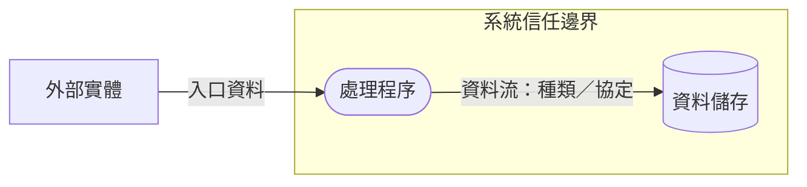

# 威脅模型交付格式

按系統規模調整章節。除非證據支持，不得把候選威脅寫成已確認漏洞。

## 1. 範圍與目的

- 系統／變更範圍：
- 建模目的與日期：
- 參與者／風險負責人：
- 排除範圍及理由：
- 已知限制：

## 2. 假設與證據

| ID | 說明 | 類型（觀察／文件／使用者確認／推論／未知） | 證據位置／確認者 | 信心或待辦 |
|:--|:--|:--|:--|:--|

## 3. DFD 與邊界

附 DFD，並列出圖例、外部實體、處理程序、資料儲存、資料流與信任邊界。指出敏感資料、入口點、出口點、外部依賴及跨邊界資料。

## 4. 威脅登錄表

| ID | DFD 元素／邊界 | STRIDE／類別 | 攻擊者與情境 | 資產與影響 | 既有控制／證據 | 可能性 | 影響 | 暫定優先級 | 建議處置與驗證 | 狀態／責任人 |
|:--|:--|:--|:--|:--|:--|:--|:--|:--|:--|:--|

每筆情境以具體條件描述攻擊路徑、所需能力或前置條件。若缺少證據，標示「待確認」；若是程式碼已觀察到的行為，也不能僅因此斷言可被利用。

## 5. 排序方法與決策

- 使用的風險矩陣／尺度：
- 評估假設與理由：
- 優先處理項目及排序理由：
- 已接受風險、核准者與日期：
- 尚未決定的風險：

## 6. 行動與驗證

| 威脅 ID | 控制／工作項目 | 驗收條件或測試證據 | 負責人 | 狀態 | 殘餘風險 |
|:--|:--|:--|:--|:--|:--|

## 7. 未決問題與更新條件

列出待確認問題、負責確認者（若已知）及會觸發重新建模的架構、資料、權限、依賴或部署變更。
